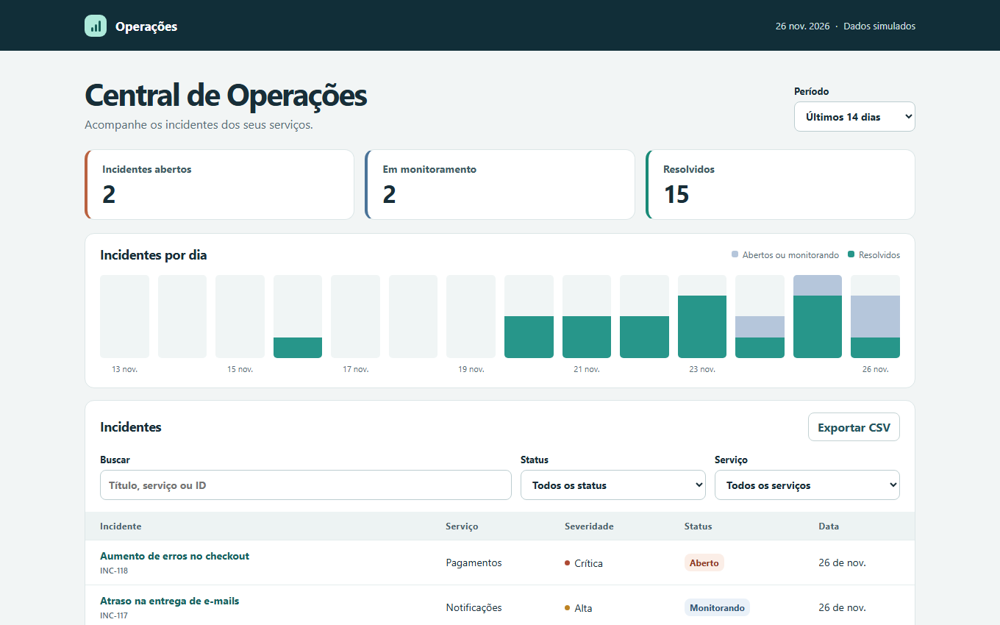

# Painel de Operações

Painel em React e TypeScript para acompanhar uma fila de incidentes. O exemplo usa dados simulados e uma data de referência fixa. O período, a busca, o serviço e o status filtram a tabela, os indicadores, o gráfico e o CSV.

Os filtros aparecem na URL. Copie o endereço do navegador para compartilhar a visualização selecionada. Alterar um filtro atualiza o endereço sem criar uma nova entrada no histórico.

## Executar

Node.js 22.12+ e npm.

~~~text
npm ci
npm run dev
npm test
npm run build
~~~

Consulte o endereço local exibido pelo Vite. O painel tem uma interface responsiva, um diálogo nativo para detalhes e um CSV com separador ponto e vírgula para abertura em planilhas configuradas para português brasileiro.

A lógica de filtros, intervalos de data e CSV está em src/model.ts. Os testes cobrem busca sem acentos, datas de fronteira, dias sem incidentes e proteção contra fórmulas em células exportadas. A aplicação funciona como demonstração de frontend com dados incorporados.

## English

An incident operations dashboard with Brazilian Portuguese localization, responsive filters, accessible details, and CSV export. Independent portfolio project built with AI assistance.

- [React](https://react.dev/)
- [Vite](https://vite.dev/)

O botão **Limpar filtros** restaura todos os filtros de incidentes e o período inicial.
